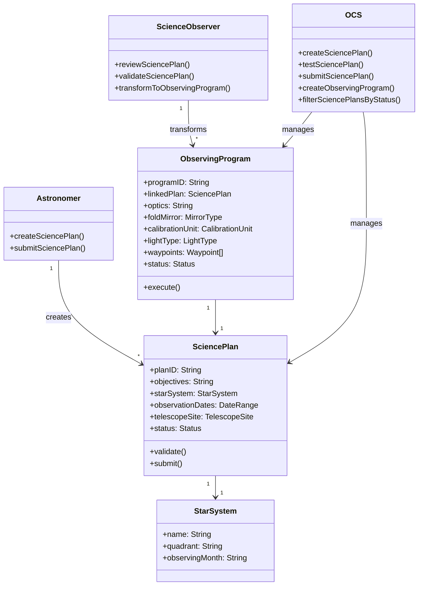
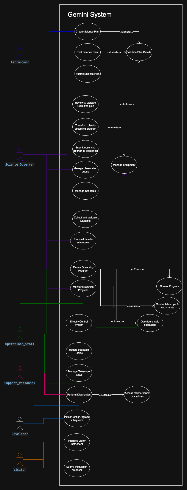
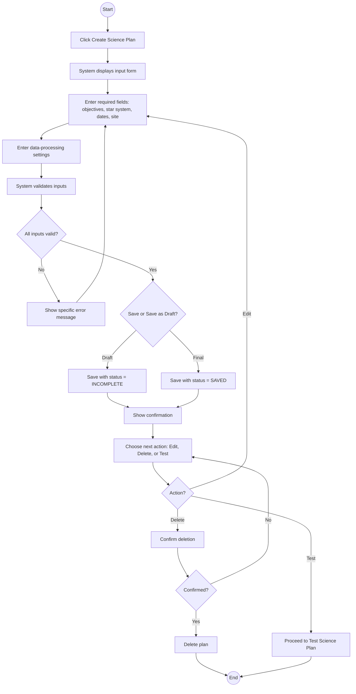
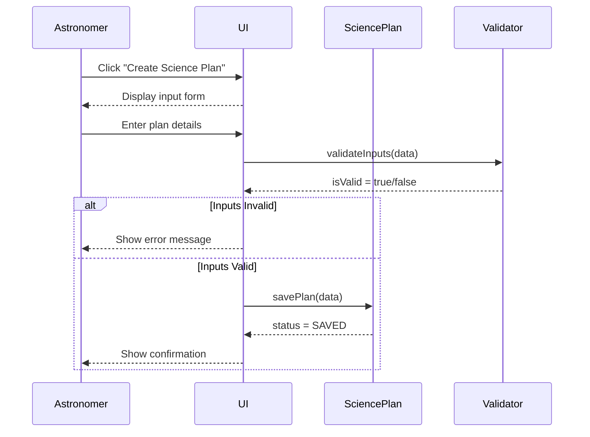
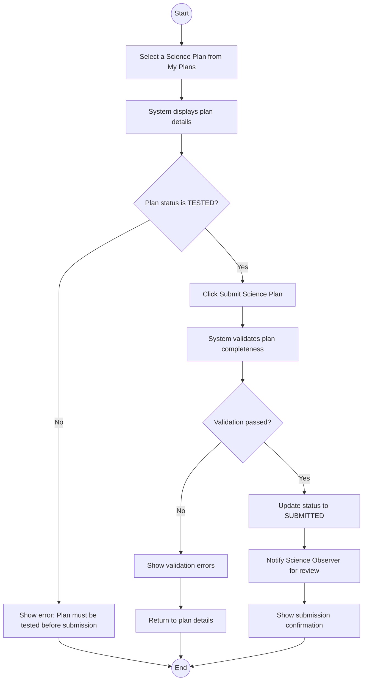

# Gemini Telescope Control System

An Operational Control System (OCS) for the **Gemini Observatory** — a real-world twin-telescope facility operated by an international partnership of seven countries. This project implements the software that astronomers use to plan, validate, and execute telescope observations.

Built as part of **ITCS382 — Software Design and Development** at the Faculty of Information and Communication Technology, Mahidol University.

## What This Project Does

Astronomers cannot simply point a telescope at the sky and start observing. Every observation requires a structured plan that specifies what to look at, when, with which instruments, and how to process the captured data. This system manages that entire workflow:

1. **Astronomers** create science plans — defining targets, observation windows, funding, and data processing settings
2. **The system** validates the plan against the star catalogue, telescope schedule, and instrument constraints
3. **Science Observers** review and transform approved plans into executable observing programs
4. **Operations Staff** execute the programs, controlling telescope optics, mirror positioning, and calibration

The system enforces a strict status lifecycle to ensure only validated plans reach the telescope:

```
CREATED --> TESTED --> SUBMITTED --> VALIDATED --> RUNNING --> COMPLETE
```

## Architecture

### Design Patterns

**Facade Pattern** — `SciencePlanFacade` and `ObservingProgramFacade` provide simplified entry points that hide the complexity of repositories, validators, star catalogues, and telescope scheduling from the actors.

**Template Method** — Abstract base classes in the `model` package define the extension points that the Gemini API requires, while concrete implementations handle domain-specific logic.

**Strategy Pattern** — Configurable enums (FileType, CalibrationUnit, LightType, FoldMirrorType) allow flexible instrument and data processing configuration without modifying core logic.

### Class Diagram



## Design Documents

### Use Case Diagram



The system supports four actor types: Astronomer, Science Observer, Operations Staff, and Visitor — each with distinct responsibilities in the observation pipeline.

### Activity Diagram — Create Science Plan



### Sequence Diagram — Create Science Plan



### Activity Diagram — Submit Science Plan



## Project Structure

```
gemini-telescope-control-system/
├── README.md
├── docs/
│   ├── requirements.md                  # Functional & non-functional requirements
│   ├── analysis.md                      # Complete system analysis (use cases, diagrams)
│   ├── design.md                        # Detailed design with activity & sequence diagrams
│   └── diagrams/
│       ├── usecase.png                  # Use case diagram
│       └── usecase.drawio              # Editable source (draw.io)
├── gemini-1/
│   └── (Phase 1 deliverables)
└── ocs/
    ├── pom.xml                          # Maven configuration (Java 19, JUnit 5)
    └── src/
        ├── main/java/edu/gemini/
        │   ├── Main.java                # Runnable demo
        │   ├── OCS.java                 # Core OCS implementation (GeminiAPI)
        │   ├── SciencePlan.java         # Science plan with validation & status
        │   ├── ObservingProgram.java     # Telescope program configuration
        │   ├── Astronomer.java          # Astronomer actor
        │   ├── ScienceObserver.java     # Science observer actor
        │   └── model/                   # Abstract base types (API contract)
        └── test/java/
            ├── TestCreateSciencePlan.java
            ├── TestSubmitSciencePlan.java
            └── TestCreateAnObservingProgram.java
```

## Getting Started

### Prerequisites

- Java 19 or later
- Apache Maven 3.9+

### Build and Run

```bash
cd ocs
mvn test                                                      # run JUnit 5 tests
mvn -DskipTests package                                       # build the JAR
java -cp target/ocs-1.0-SNAPSHOT.jar edu.gemini.Main          # run the demo
```

The demo creates a science plan for observing Andromeda, runs it through testing and submission, then assembles an observing program with telescope optics configuration.

### Run in an IDE

1. Open the `ocs` directory in IntelliJ IDEA or Eclipse
2. Ensure Java SDK 19+ is configured
3. Run `src/main/java/edu/gemini/Main.java`

## Key Features

**Science Plan Management** — Create plans with auto-generated IDs, validate against star catalogue availability, enforce date ranges, check funding, and detect naming conflicts.

**Status Workflow** — Plans progress through a strict lifecycle (CREATED, TESTED, SUBMITTED, VALIDATED) with gating rules that prevent premature submission or execution.

**Observing Program Assembly** — Transform validated plans into executable programs by configuring telescope optics (primary/secondary mirrors), fold mirror types, calibration units, light sources, and azimuth/elevation waypoints.

**Data Processing Configuration** — Define output formats (PNG, JPEG, RAW), quality levels, color modes, and fine-tune image parameters (contrast, brightness, saturation, exposure, highlights, shadows).

**Validation Framework** — Input field requirements, date conflict detection, target star availability checks, and data format verification with specific error messages.

## Tech Stack

- **Language**: Java 19
- **Build**: Apache Maven 3.9
- **Testing**: JUnit 5 (Jupiter)
- **Modeling**: Mermaid (class, activity, sequence diagrams), draw.io (use case diagram)

## Authors

ITCS382 Section 02, Team Gemini5 (No_Comment) — Mahidol University

## License

This project was created for educational purposes as part of university coursework.
