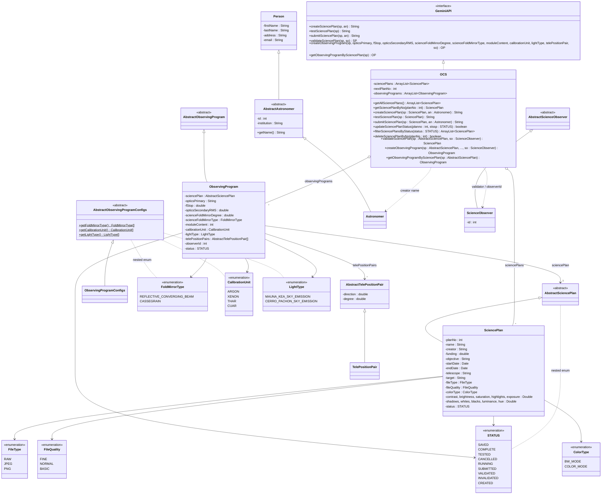
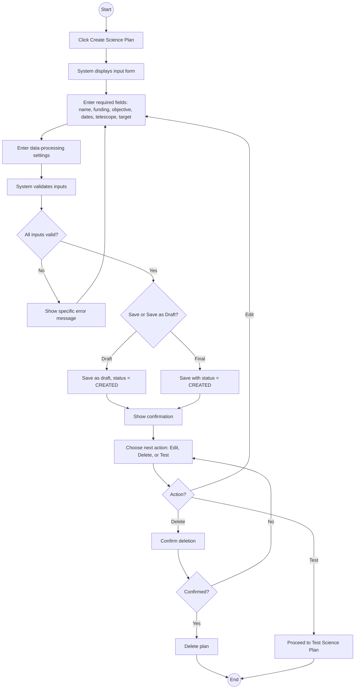
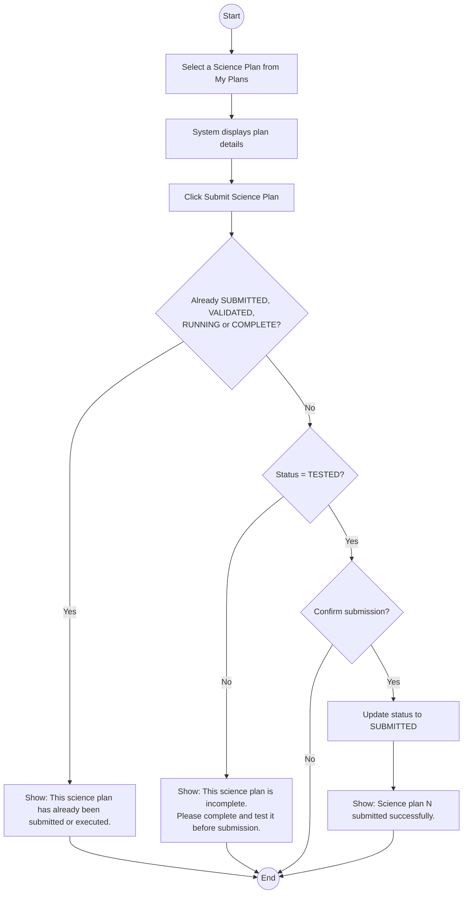

# Gemini Telescope Control System

An Operational Control System (OCS) for the **Gemini Observatory** — a real-world twin-telescope facility (Gemini North on Mauna Kea, Hawaii, and Gemini South on Cerro Pachón, Chile). This project analyses, designs and prototypes the software that astronomers and science observers use to prepare telescope observations.

Built as part of **ITCS382 — Software Design and Development** at the Faculty of Information and Communication Technology, Mahidol University.

## What This Project Does

Astronomers cannot simply point a telescope at the sky and start observing. Every observation requires a structured plan that specifies what to look at, when, with which telescope, and how to process the captured data. The course project covers that workflow in two phases:

- **Phase 1 (analysis)** — requirements, a use case diagram for the whole Gemini system, and analysis of five use cases (`docs/requirements.md`, `docs/diagrams/`, `docs/analysis.md`).
- **Phase 2 (design + prototype)** — revised designs for the three assigned use cases (`docs/design.md`) and a command-line Java prototype of the OCS (`gemini-1/implementations/ocs`) that implements the instructor-supplied `GeminiAPI` interface.

The three use cases assigned in Phase 2 are **Create Science Plan**, **Submit Science Plan** and **Create Observing Program**. The prototype also contains a minimal **Validate Science Plan** step, because an observing program can only be created from a validated plan:

1. An **Astronomer** creates a science plan (target, dates, telescope, funding, data-processing settings)
2. The plan is tested and then submitted by the Astronomer
3. A **Science Observer** validates the submitted plan
4. The Science Observer turns the validated plan into an **observing program** (optics, fold mirror, calibration unit, light type, telescope position pairs)

Science plan statuses follow the product owner's narrative:

```
CREATED --> TESTED --> SUBMITTED --> VALIDATED --> RUNNING --> COMPLETE
```

A submitted plan that the science observer rejects becomes `INVALIDATED`, and a plan can also be `CANCELLED`. The prototype moves a plan from `CREATED` to `VALIDATED` (or `INVALIDATED`). `RUNNING`, `COMPLETE` and `CANCELLED` belong to later use cases (execution) that are not implemented.

## Architecture

### Design vs. implementation

The Phase 2 design (`docs/design.md`) proposed a **Facade**-based structure: `SciencePlanFacade` and `ObservingProgramFacade` in front of repositories, a `Validator`, a `StarCatalog` and a `TelescopeSchedule`.

The implementation does not contain those classes. It consolidates their responsibilities in a single class, `OCS`, which:

- implements the instructor-supplied generic interface `GeminiAPI` (type parameters bound to `SciencePlan`, `ObservingProgram`, `Astronomer`, `ScienceObserver`, …), so `OCS` is the single entry point for every use case;
- keeps science plans and observing programs in in-memory `ArrayList`s (no database);
- does the input checks itself (there is no separate validator class).

The domain classes extend the abstract types supplied in `edu.gemini.model`, and option sets (status, file type, file quality, color type, fold mirror type, calibration unit, light type) are plain Java enums.

### Class Diagram (implementation)

This diagram reflects the code in `gemini-1/implementations/ocs/src/main/java`. Only the `GeminiAPI` methods that `OCS` actually implements are listed; the remaining API methods (schedule, astronomical data, live view, commands, configurations, `saveObservingProgram`) are stubs that return `null`/`false`. The supplied `StarSystem` and `Quadrant` catalogue classes exist but are not used by `OCS` yet.



Notes: `STATUS` is `AbstractSciencePlan.STATUS` from the supplied API; it also contains `SAVED`, which the narrative does not use and the prototype never sets. `FileType`, `FileQuality` and `ColorType` are nested in `SciencePlan`. `ObservingProgram` reuses the science-plan `STATUS` enum and is created with status `CREATED`.

## Design Documents

### Use Case Diagram


The diagram has six actors: Astronomer, Science Observer, Operations Staff, Support Personnel, Developer and Visitor. Phase 2 implements three of the Astronomer / Science Observer use cases (Create Science Plan, Submit Science Plan, Create Observing Program).

The full Phase 2 activity and sequence diagrams for the three use cases, and the design class diagram, are in [`docs/design.md`](docs/design.md). Two of them are summarised below.

### Activity Diagram — Create Science Plan



### Activity Diagram — Submit Science Plan



## Project Structure

```
gemini-telescope-control-system/
├── README.md
├── docs/
│   ├── requirements.md                  # Phase 1: functional & non-functional requirements
│   ├── usecase_overview.md              # Phase 1: link to the use case deliverable
│   ├── analysis.md                      # Phase 1: analysis of 5 use cases (descriptions, diagrams)
│   ├── design.md                        # Phase 2: activity, sequence and class diagrams (3 use cases)
│   └── diagrams/
│       ├── usecase.png                  # Use case diagram
│       └── usecase.drawio               # Editable source (draw.io)
└── gemini-1/                            # Phase 2 deliverable folder
    ├── Gemini-1.md                      # Phase 2 README (how to run the prototype)
    ├── designs/README.md                # Points to docs/design.md
    └── implementations/
        └── ocs/
            ├── pom.xml                  # Maven configuration (Java 19, JUnit 5)
            └── src/
                ├── main/java/edu/gemini/
                │   ├── Main.java                # Runnable demo
                │   ├── GeminiAPI.java           # Instructor-supplied interface
                │   ├── OCS.java                 # GeminiAPI implementation (in-memory)
                │   ├── SciencePlan.java         # Science plan fields, enums and status
                │   ├── ObservingProgram.java    # Observing program configuration
                │   ├── Astronomer.java          # Astronomer actor
                │   ├── ScienceObserver.java     # Science observer actor
                │   ├── TelePositionPair.java    # Telescope position pair
                │   └── model/                   # Abstract base types supplied with the API
                └── test/java/
                    ├── TestCreateSciencePlan.java
                    ├── TestCreateSciencePlanTest.java
                    ├── TestSubmitSciencePlan.java
                    ├── TestValidateSciencePlan.java
                    └── TestCreateAnObservingProgram.java
```

## Getting Started

### Prerequisites

- JDK 19 or later (`pom.xml` compiles for Java 19)
- Apache Maven 3.9+

### Build and Run

From the repository root:

```bash
cd gemini-1/implementations/ocs
mvn test                                                      # run JUnit 5 tests
mvn -DskipTests package                                       # build the JAR
java -cp target/ocs-1.0-SNAPSHOT.jar edu.gemini.Main          # run the demo
```

Without Maven, the demo can be compiled and run with the JDK alone:

```bash
cd gemini-1/implementations/ocs
javac --release 19 -d /tmp/ocs-classes $(find src/main/java -name "*.java")
java -cp /tmp/ocs-classes edu.gemini.Main
```

The demo (`Main.java`) creates the science plan "Galaxy Observation Plan" for a sample astronomer, targeting the **Gemini** constellation (quadrant NQ2, observed in February) on the **Hawaii** telescope (Gemini North) for 1–5 February 2025. It then tests, submits and validates the plan, creates an observing program from the validated plan with Gemini North settings (`GNZ` optics, `MAUNA_KEA_SKY_EMISSION` light type, `ARGON` calibration unit, one telescope position pair), and prints the result of each step and a summary.

### Run in an IDE

1. Open the `gemini-1/implementations/ocs` directory in IntelliJ IDEA or Eclipse
2. Ensure a JDK 19+ is configured
3. Run `src/main/java/edu/gemini/Main.java`

## What the Implementation Checks

**Create Science Plan** (`createSciencePlan`) — rejects a plan with an empty name, funding that is not positive, a start date after the end date, or a name that already exists. On success it assigns an auto-incremented plan number, records the astronomer's full name as creator, sets status `CREATED` and stores the plan in memory.

**Test Science Plan** (`testSciencePlan`) — moves a `CREATED` plan to `TESTED`. No simulation or further checks are run.

**Submit Science Plan** (`submitSciencePlan`) — rejects a missing plan; rejects a plan that is already `SUBMITTED`, `VALIDATED`, `RUNNING` or `COMPLETE`; rejects a plan that is not `TESTED`; otherwise sets `SUBMITTED`.

**Validate Science Plan** (`validateSciencePlan`, minimal) — only accepts a `SUBMITTED` plan (otherwise returns `null` and leaves the status unchanged). It sets `VALIDATED` when plan number, name, creator, funding and objective are present, otherwise `INVALIDATED`. The narrative's star-system rules (quadrant vs. telescope, observing month) and recording the validator's name and time are **not** implemented.

**Create Observing Program** (`createObservingProgram`) — only accepts a `VALIDATED` plan and a science observer (otherwise returns `null`). It stores the given optics, f-stop, secondary RMS, fold mirror degree and type, module content, calibration unit, light type and telescope position pairs, records the observer's id, sets status `CREATED`, keeps the program in memory and links it to the plan (`getObservingProgramBySciencePlan`). The value ranges in the API documentation (f-stop, RMS, mirror degree, module content) are not checked.

**Not implemented** — star-catalogue lookup, schedule/date-conflict detection, persistence (everything is in memory), telescope execution, and the other `GeminiAPI` methods listed above.

## Tests

`src/test/java` contains 13 JUnit 5 tests in five classes: plan creation (success and error paths), submission (valid, missing, already submitted, not tested), minimal validation, and observing-program creation from a validated plan (and rejection of a plan that is not validated).

## Tech Stack

- **Language**: Java (compiled for Java 19)
- **Build**: Apache Maven 3.9
- **Testing**: JUnit 5 (Jupiter 5.10.2)
- **Modeling**: Mermaid (class, activity, sequence diagrams), draw.io (use case diagram)

## Authors

ITCS382 Section 02, Team Gemini5 (No_Comment) — Mahidol University

## License

This project was created for educational purposes as part of university coursework.

## Revision note (Nov 2026, after the course)

The repository was reviewed after the course and the following were corrected.

- **Build fix** — `OCS.validateSciencePlan` returned `ObservingProgram`, which does not match `GeminiAPI` (`SP validateSciencePlan(...)`), so the project did not compile. It now returns `SciencePlan` with the minimal behaviour described above.
- **Create Observing Program** — now requires a `VALIDATED` plan (as the design says) and stores the program in memory (the storage line was commented out); `getObservingProgramBySciencePlan` returns it.
- **Demo** — `Main` now runs create → test → submit → validate → create observing program, and uses the Hawaii telescope for the NQ2 target "Gemini" (it previously used Chile).
- **Tests** — `TestSubmitSciencePlan` built its plan with funding 0, so creation silently failed and the test bypassed the OCS; it now creates and tests the plan through the OCS. The empty `TestCreateSciencePlanTest` now covers creation error paths, `TestCreateAnObservingProgram` goes through validation first, and `TestValidateSciencePlan` was added.
- **README** — corrected paths (`gemini-1/implementations/ocs`), phases, actor count, design-pattern and validation claims, and replaced the Phase 1 analysis class diagram with one drawn from the actual code.
- **Design (`docs/design.md`)** — status names aligned with the narrative (no `INCOMPLETE`/`SAVED`), the Submit Science Plan activity and sequence diagrams require `TESTED`, check "already submitted" before changing anything and set `SUBMITTED` on success, the Submit sequence uses the Astronomer and the design classes instead of a generic User/System, enum values (calibration unit, file quality) and entity fields follow the code, sequence-diagram participants and method names match the class diagram, and the "Technical Team" (not an actor) was removed.
- **Analysis (`docs/analysis.md`)** — status names aligned (no `SAVED`/`PAUSED`/`COMPLETED`), waypoints and mirror/calibration/light-type configuration moved out of the science-plan use cases (they are observing-program fields) and replaced with data-processing checks, calibration units fixed, UC04 named "Create Observing Program".
- **Requirements (`docs/requirements.md`)** — removed a leftover "(truncated for brevity …)" note, renumbered the duplicated Operations Staff FR1–FR15 as FR43–FR57, and put FR39–FR42 after FR24–FR38.
- **Use case diagram** — «extend» arrows now point from the extension to the base use case, «include»/«extend» drawn as dashed open arrows with lower-case stereotypes, typos fixed ("Execute", "maintenance"), actor associations drawn without arrowheads, "Transform plan to observing program" renamed to "Create Observing Program", and the PNG re-exported from the `.drawio` source.
