# Complete Analysis Documentation

**Gemini Observatory - Science Plan Management System**  
**Team: No_Comment**  
**Date: October 12, 2025**

---

## Table of Contents

1. [Class Diagram](#class-diagram)
2. [UC01: Create Science Plan](#uc01-create-science-plan)
   - Use Case Description
   - Activity Diagram
   - Sequence Diagram
3. [UC02: Submit Science Plan](#uc02-submit-science-plan)
   - Use Case Description
   - Activity Diagram
   - Sequence Diagram
4. [UC03: Review & Validate Submitted Plan](#uc03-review--validate-submitted-plan)
   - Use Case Description
   - Activity Diagram
   - Sequence Diagram
5. [UC04: Create Observing Program](#uc04-create-observing-program)
   - Use Case Description
   - Activity Diagram
   - Sequence Diagram
6. [UC05: Execute Observing Program](#uc05-execute-observing-program)
   - Use Case Description
   - Activity Diagram
   - Sequence Diagram

---

# Class Diagram

## Gemini Class Diagram

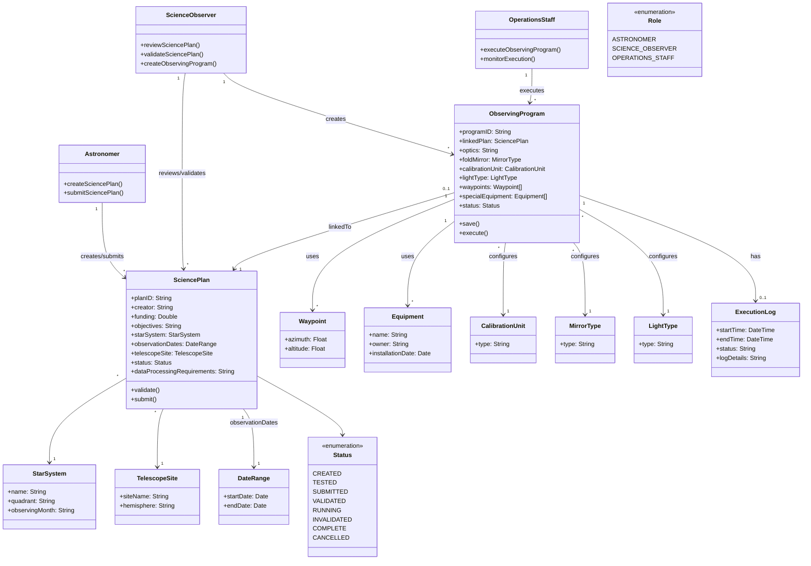

---

# UC01: Create Science Plan

## Use Case Description

### Use Case Name

Create Science Plan

### Use Case ID

01

### Use Case Type

Detail and Essential

### Primary Actor

Astronomer

### Importance Level

High

### Stakeholders and Interest

- Astronomer
- Science Observer

### Brief Description

The Astronomer creates a new science plan by entering required information such as plan ID, objectives, target star system, observation dates, and telescope location. After finishing input, the plan will be in "CREATED" status for the Astronomer to edit, delete and test later before submitting.

### Trigger

External trigger

---

## Activity Diagram

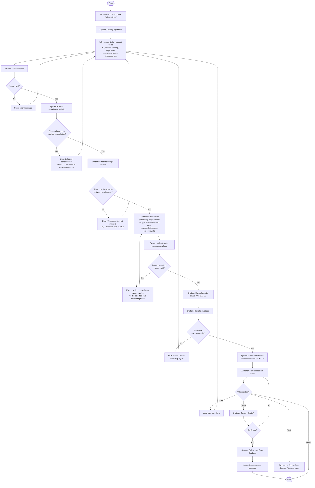

---

## Sequence Diagram

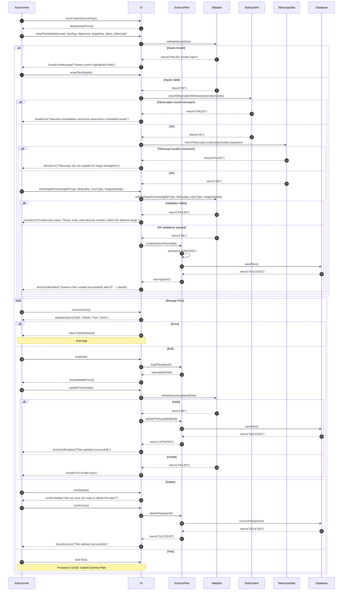

---

# UC02: Submit Science Plan

## Use Case Description

### Use Case Name

Submit Science Plan

### Use Case ID

02

### Use Case Type

Detail and Essential

### Primary Actor

Astronomer

### Importance Level

High

### Stakeholders and Interest

- Astronomer
- Science Observer
- System

### Brief Description

After completing and testing the science plan, the Astronomer submits it for review. The system checks that the plan has passed required tests and contains valid information. If all checks pass, the system updates the plan's status to "SUBMITTED" and stores it for later validation by the Science Observer.

### Trigger

External trigger

---

## Activity Diagram

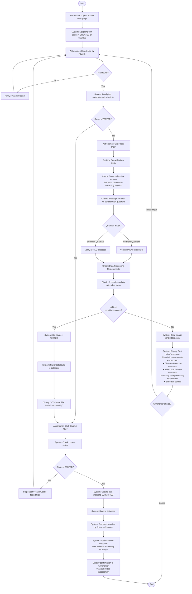

---

## Sequence Diagram

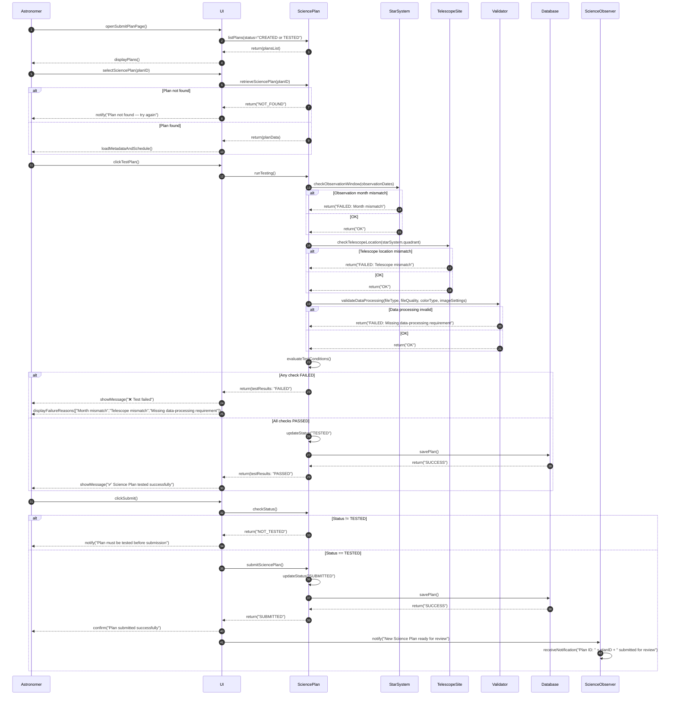

---

# UC03: Review & Validate Submitted Plan

## Use Case Description

### Use Case Name

Review & Validate Submitted Plan

### Use Case ID

03

### Use Case Type

Detail and Essential

### Primary Actor

Science Observer

### Importance Level

High

### Stakeholders and Interest

- Science Observer
- Astronomer
- System

### Brief Description

The Science Observer retrieves a submitted science plan and reviews its details. The system supports validation by checking the plan's star system visibility, telescope site suitability, plan metadata and data-processing requirements. Based on the results, the observer marks the plan as either "VALIDATED" or "INVALIDATED".

### Trigger

External trigger

---

## Activity Diagram

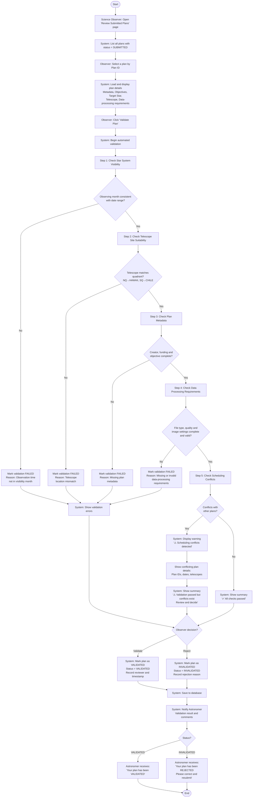

---

## Sequence Diagram

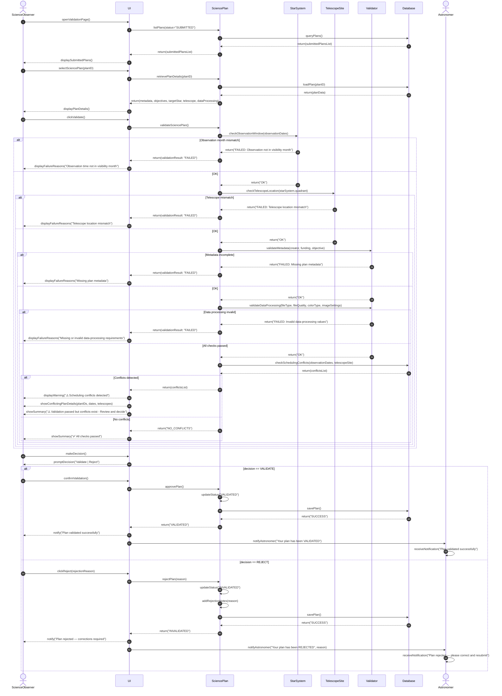

---

# UC04: Create Observing Program

## Use Case Description

### Use Case Name

Create Observing Program (transform a validated plan into an observing program)

### Use Case ID

04

### Use Case Type

Detail and Essential

### Primary Actor

Science Observer

### Importance Level

Medium

### Stakeholders and Interest

- Science Observer
- Astronomer

### Brief Description

After a science plan is validated, the Science Observer can transform it into an Observing Program. The Science Observer can provide additional required information such as optics, fold mirror, calibration unit, light type, waypoints, and special equipment. Once complete, the system saves the program and links it to the original science plan.

### Trigger

External trigger

---

## Activity Diagram

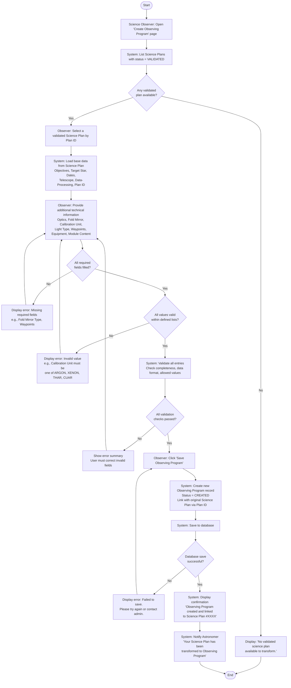

---

## Sequence Diagram

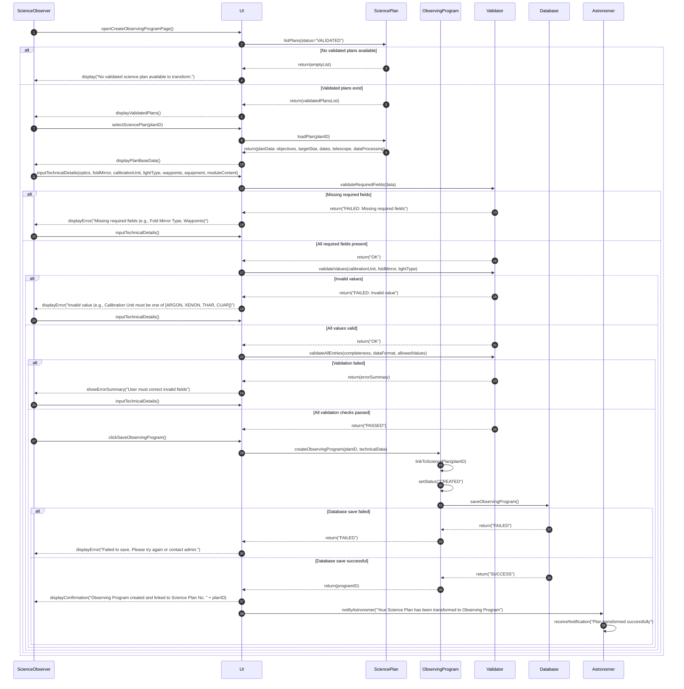

---

# UC05: Execute Observing Program

## Use Case Description

### Use Case Name

Execute Observing Program

### Use Case ID

05

### Use Case Type

Detail and Essential

### Primary Actor

Operations Staff

### Importance Level

High

### Stakeholders and Interest

- Operations Staff
- Science Observer

### Brief Description

Operations Staff selects a submitted Observing Program and starts the execution process. Throughout the program, the staff actively monitors telescope status, confirms critical steps, and manually performs actions such as pausing, resuming, or canceling as needed. The system assists by displaying real-time feedback, logging actions, and alerting the staff to potential issues. The staff is responsible for deciding how to respond during execution.

### Trigger

External trigger

---

## Activity Diagram

```mermaid
flowchart TD

A0([Start]) --> A1[Operations Staff: Open Execute Page]
A1 --> A2[System: List programs with status = CREATED]
A2 --> A3{Any program<br/>available?}
A3 -- No --> E1[Display: 'No program to run']
E1 --> A99([End])

A3 -- Yes --> A4[Ops Staff: Select program]
A4 --> A5[System: Show details<br/>target, telescope, schedule,<br/>waypoints, equipment]

A5 --> A6[System: Run pre-execution checks]
A6 --> A7{Any issues?}
A7 -- Yes --> E2[Display issues found:<br/>• Calibration error<br/>• Telescope busy<br/>• Missing waypoint]
E2 --> A5

A7 -- No --> A8{Another program RUNNING<br/>on same telescope?}
A8 -- Yes --> E3[Display: 'Program already running<br/>on this telescope']
E3 --> A5

A8 -- No --> A9[System: Enable Start button]
A9 --> A10[Ops Staff: Click Start]
A10 --> A11[System: Update status → RUNNING]
A11 --> A12[System: Create execution log<br/>Log: Started, timestamp]
A12 --> A13[System: Save status to database]
A13 --> A14[System: Show real-time monitor]

%% Execution loop
A14 --> A15[System: Begin waypoint processing]
A15 --> A16{Process next waypoint}
A16 -- Yes --> A17[Move telescope to waypoint<br/>azimuth, altitude]
A17 --> A18[Capture astronomical data]
A18 --> A19[Store dataset for this waypoint]

A19 --> A20{Problem detected?}
A20 -- Yes --> A21[System: Alert operator<br/>• Telescope failure<br/>• Weather bad<br/>• Hardware error]
A21 --> A22[Ops Staff: Choose action]
A22 --> A23{Which action?}

A23 -- Pause --> P1[System: Pause execution<br/>status stays RUNNING]
P1 --> LP[Log: Paused, reason, timestamp]
LP --> A24[System: Save to database]
A24 --> A25[Monitor shows: Paused]
A25 --> A26[Wait for operator action]
A26 --> A27[Ops Staff: Click Resume]
A27 --> P2[System: Update status → RUNNING]
P2 --> LR[Log: Resumed, timestamp]
LR --> A28[System: Save to database]
A28 --> A16

A23 -- Resume --> P2

A23 -- Cancel --> P3[System: Update status → CANCELLED]
P3 --> LC[Log: Cancelled, reason, timestamp]
LC --> A29[System: Save to database]
A29 --> A30[System: Show execution summary<br/>Completed waypoints, logs]
A30 --> A99

A20 -- No --> A31[Update progress display]
A31 --> A32{All waypoints<br/>processed?}
A32 -- No --> A16
A32 -- Yes --> A33[System: Update status → COMPLETE]

%% Data collection and management (FR39-FR42)
A33 --> A34[System: Collect all datasets from waypoints]
A34 --> A35[System: Validate data integrity<br/>Check file completeness,<br/>checksum, metadata consistency]
A35 --> A36{Data validation<br/>passed?}
A36 -- No --> A37[Log: Data validation warnings<br/>List incomplete/corrupt files]
A37 --> A38[System: Flag datasets for review]
A38 --> A39

A36 -- Yes --> A39[System: Catalog datasets<br/>Organize by program ID,<br/>waypoint, timestamp]
A39 --> A40[System: Save datasets to database]
A40 --> A41[System: Associate data with<br/>Observing Program record]

A41 --> A42[Log: Completed, timestamp]
A42 --> A43[System: Save execution log to database]
A43 --> A44[System: Generate execution summary<br/>Start-end time, waypoints completed,<br/>logs, weather conditions, dataset info]

A44 --> A45[System: Notify Science Observer<br/>'Program completed successfully']
A45 --> A46[System: Display completion summary to Ops Staff<br/>Execution details, data status]

A46 --> A47[Science Observer: Review completion and datasets]
A47 --> A48[Science Observer: Prepare data package<br/>Include metadata, execution summary, datasets]
A48 --> A49[Science Observer: Transmit data to Astronomer]

A49 --> A50[Astronomer: Receive astronomical data]
A50 --> A51[Astronomer: Acknowledge receipt]
A51 --> A52[Science Observer: Receive confirmation<br/>'Data successfully delivered']
A52 --> A99
```

---

## Sequence Diagram

```mermaid
sequenceDiagram
    autonumber
    actor Ops as OperationsStaff
    participant UI as ExecutePageUI
    participant OP as ObservingProgram
    participant TEL as TelescopeSite
    participant LOG as ExecutionLog
    participant DB as Database
    participant SO as ScienceObserver
    participant A as Astronomer

    %% === 1. Load and Select Program ===
    Ops->>UI: openExecutePage()
    UI->>OP: listPrograms(status="CREATED")
    OP->>DB: queryPrograms()
    DB-->>OP: return(programsList)
    OP-->>UI: return(programsList)

    alt No program available
        UI-->>Ops: display("No program to run")
    else Programs available
        UI-->>Ops: displayPrograms()
        Ops->>UI: selectProgram(programID)
        UI->>OP: loadProgramDetails(programID)
        OP->>DB: retrieveProgram(programID)
        DB-->>OP: return(programData)
        OP-->>UI: return(target, telescope, schedule, waypoints, equipment)
        UI-->>Ops: displayDetails()

        %% === 2. Pre-Execution Checks ===
        UI->>OP: runPreCheck()
        OP->>TEL: getTelescopeStatus()
        TEL-->>OP: return(calibration, occupancy)

        alt Issues found
            OP-->>UI: return(issues: calibration/busy/missing waypoint)
            UI-->>Ops: displayIssues("Review & adjust required")
        else No issues
            OP->>TEL: checkRunningPrograms()
            TEL-->>OP: return(isRunning)

            alt Another program running
                OP-->>UI: return("CONFLICT")
                UI-->>Ops: display("Program already running on this telescope")
            else Telescope free
                UI-->>Ops: enableStartButton()

                %% === 3. Execute Program ===
                Ops->>UI: clickStart()
                UI->>OP: execute()
                OP->>OP: updateStatus("RUNNING")
                OP->>DB: saveStatus()
                DB-->>OP: return("SUCCESS")
                OP->>LOG: createLog("Started", timestamp)
                LOG->>DB: save()
                DB-->>LOG: return("SUCCESS")
                LOG-->>OP: return(logID)
                OP-->>UI: return("STARTED")
                UI-->>Ops: showRealTimeMonitor()

                %% === 4. Execution Loop ===
                loop For each Waypoint
                    OP->>TEL: moveToWaypoint(azimuth, altitude)
                    OP->>TEL: captureData()

                    alt Problem detected
                        TEL-->>OP: return("ERROR: telescope fail | weather bad | hardware error")
                        OP-->>UI: alert(errorType)
                        UI-->>Ops: promptAction("Pause | Resume | Cancel")

                        alt Pause
                            Ops->>UI: clickPause()
                            UI->>OP: pauseExecution()
                            OP->>DB: saveStatus()
                            DB-->>OP: return("SUCCESS")
                            OP->>LOG: appendLog("Paused", reason)
                            LOG->>DB: save()
                            DB-->>LOG: return("SUCCESS")
                            LOG-->>OP: return("OK")
                            OP-->>UI: return("RUNNING (paused)")
                            UI-->>Ops: showMonitor("Paused")

                        else Resume
                            Ops->>UI: clickResume()
                            UI->>OP: updateStatus("RUNNING")
                            OP->>DB: saveStatus()
                            DB-->>OP: return("SUCCESS")
                            OP->>LOG: appendLog("Resumed", timestamp)
                            LOG->>DB: save()
                            DB-->>LOG: return("SUCCESS")
                            LOG-->>OP: return("OK")
                            OP-->>UI: return("RUNNING")
                            UI-->>Ops: showMonitor("Running")

                        else Cancel
                            Ops->>UI: clickCancel(reason)
                            UI->>OP: updateStatus("CANCELLED")
                            OP->>DB: saveStatus()
                            DB-->>OP: return("SUCCESS")
                            OP->>LOG: appendLog("Cancelled", reason)
                            LOG->>DB: save()
                            DB-->>LOG: return("SUCCESS")
                            LOG-->>OP: return("OK")
                            OP-->>UI: return(executionSummary)
                            UI-->>Ops: showSummary(completedWaypoints, logs)
                        end

                    else No problem
                        TEL-->>OP: return(dataCollected)
                        OP->>OP: storeDataset(waypointID, data)
                        OP-->>UI: updateProgress(currentWaypoint, totalWaypoints)
                        UI-->>Ops: refreshMonitor()
                    end
                end

                %% === 5. Completion & Data Management ===
                OP->>OP: updateStatus("COMPLETE")
                OP->>DB: saveStatus()
                DB-->>OP: return("SUCCESS")
                OP->>LOG: appendLog("Completed", timestamp)
                LOG->>DB: save()
                DB-->>LOG: return("SUCCESS")
                LOG-->>OP: return("OK")

                %% === 6. Data Collection & Validation (FR39-FR42) ===
                OP->>OP: collectDatasets()
                OP->>OP: validateDataIntegrity(checksum, metadata)
                OP->>DB: saveDatasets()
                DB-->>OP: return("SUCCESS")
                OP->>OP: catalogData(programID, waypointData)

                alt Data validation issues detected
                    OP-->>UI: return(executionSummary, warnings)
                    UI-->>Ops: showSummary(startTime, endTime, waypoints, logs, weather, datasetInfo)
                    UI-->>Ops: displayWarning("⚠️ Some data quality issues detected - review required")
                else All data valid
                    OP-->>UI: return(executionSummary)
                    UI-->>Ops: showSummary(startTime, endTime, waypoints, logs, weather, datasetInfo)
                end

                %% === 7. Notify Science Observer ===
                OP->>SO: notify("Program completed", programID, datasetInfo)
                SO->>SO: receiveNotification()
                SO->>SO: reviewCompletionAndDatasets()
                SO->>SO: prepareDataPackage(datasets, metadata, executionSummary)

                %% === 8. Transmit Data to Astronomer ===
                SO->>A: transmitData(dataPackage)
                A->>A: receiveData()
                A-->>SO: acknowledge("Data received successfully")
                SO->>SO: logTransmissionComplete()
            end
        end
    end
```

---
