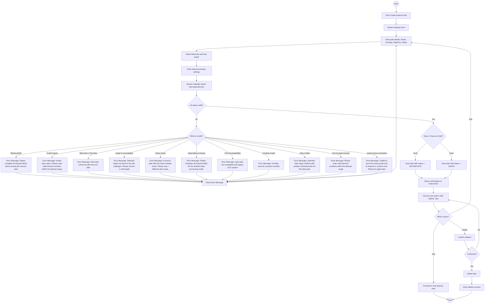
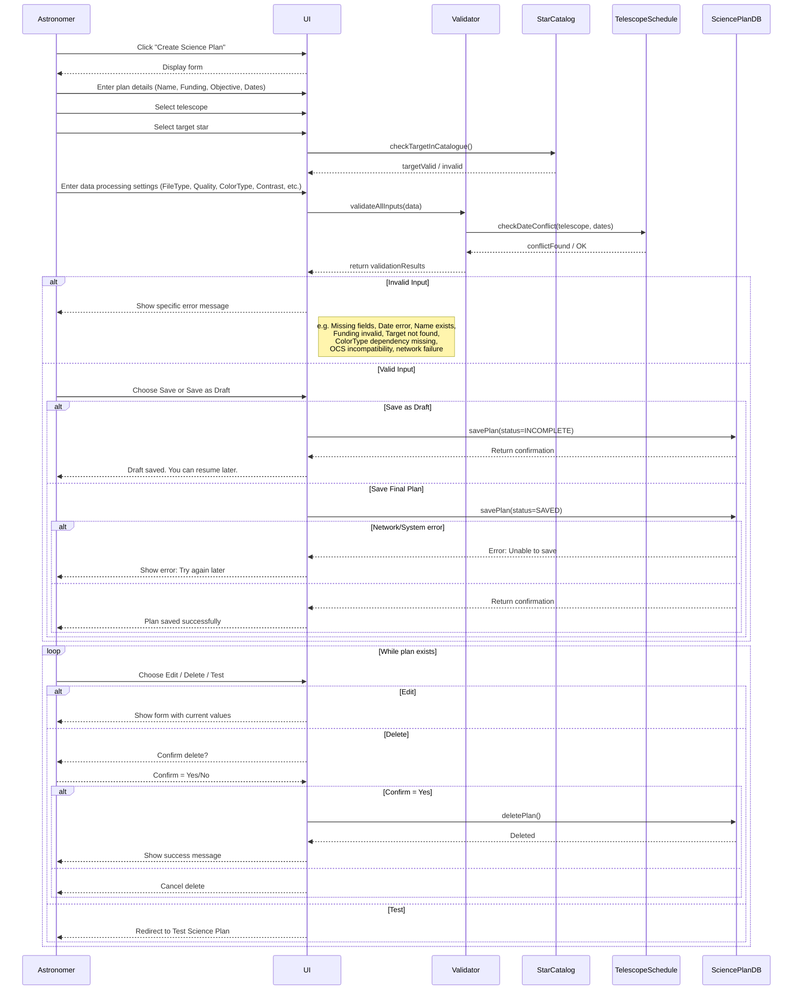
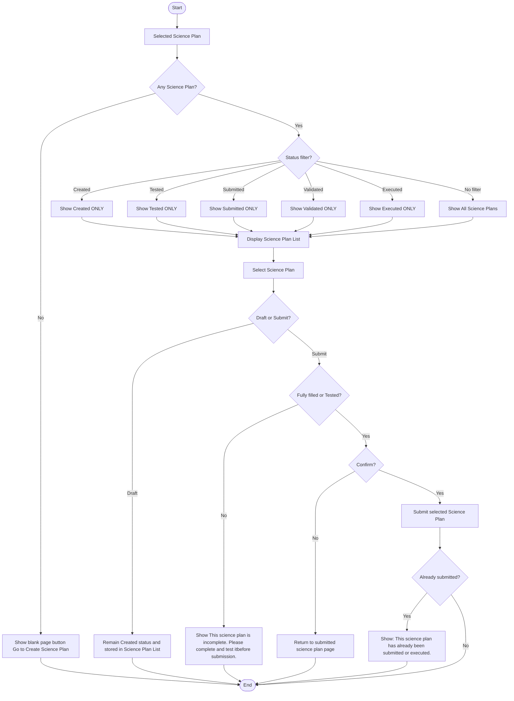
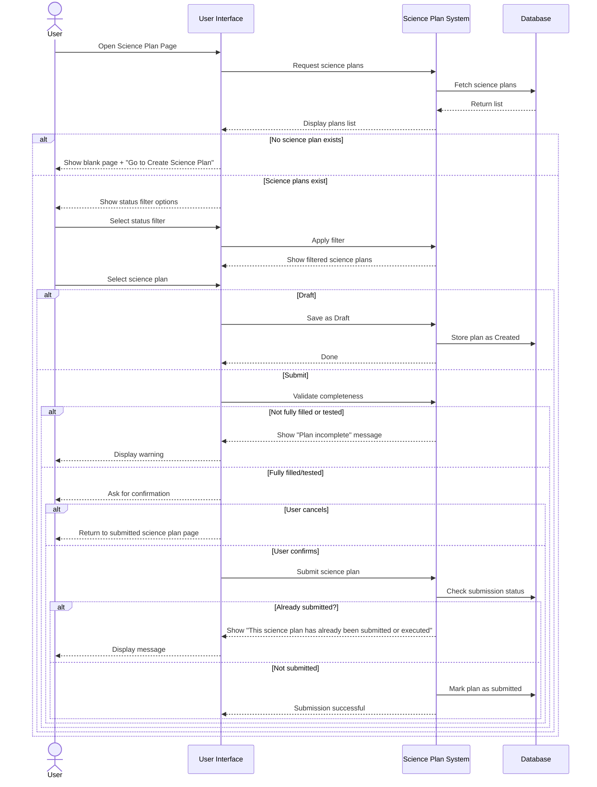
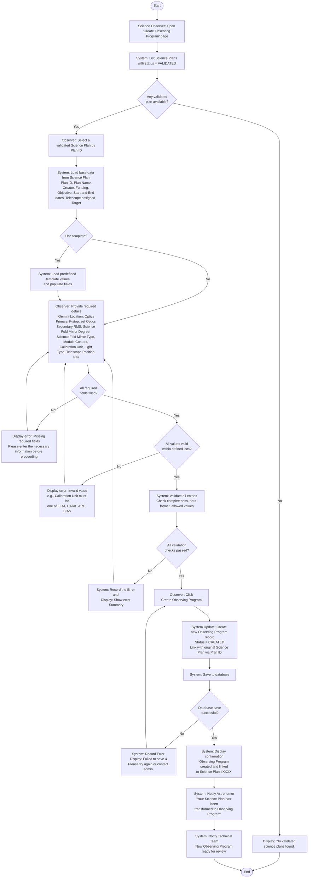
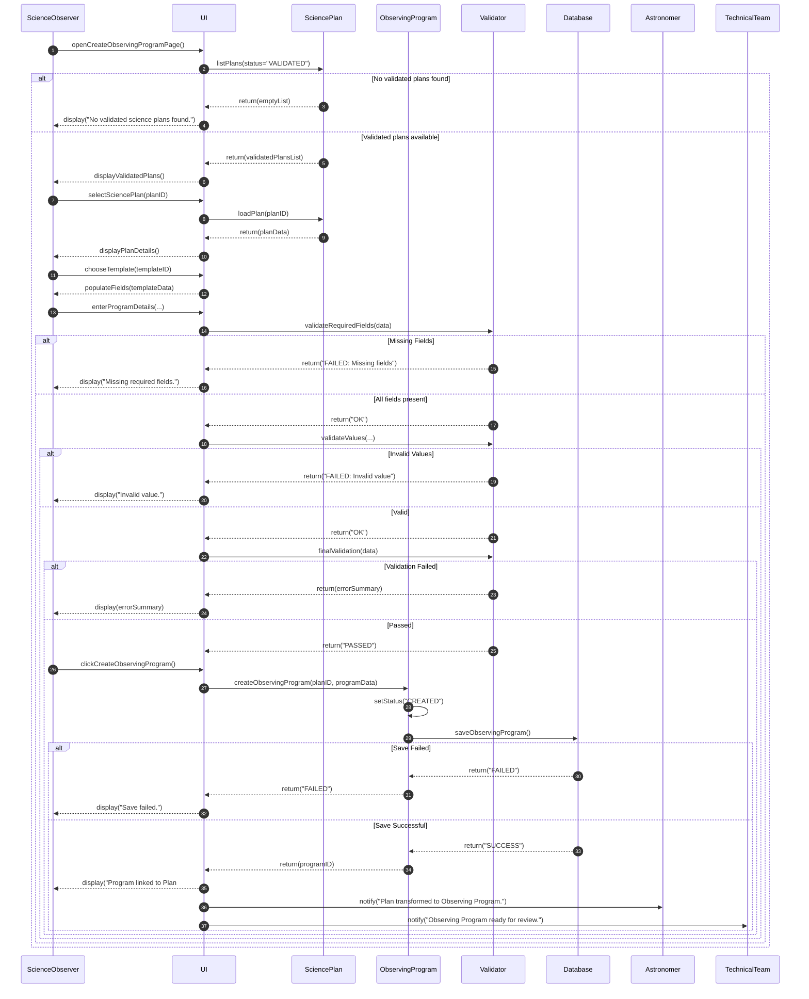
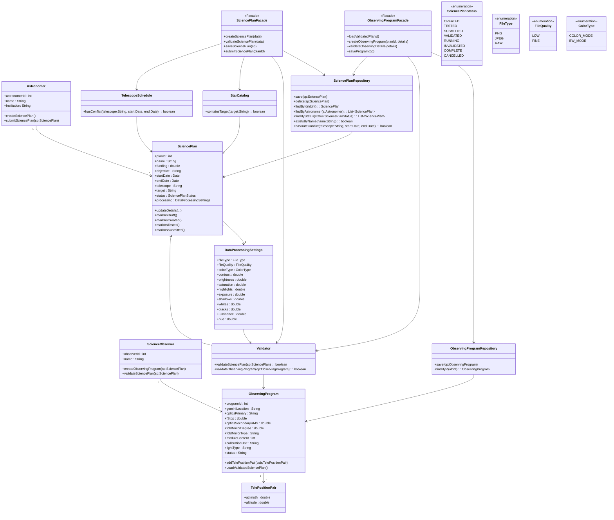

## Create Science Plan Activity Diagram

## Create Science Plan Sequence Diagram

## Submit Science Plan Activity Diagram

## Submit Science Plan Sequence Diagram

## Create Observing Program Activity Diagram

## Create Observing Program Sequence Diagram

# Class Diagram

