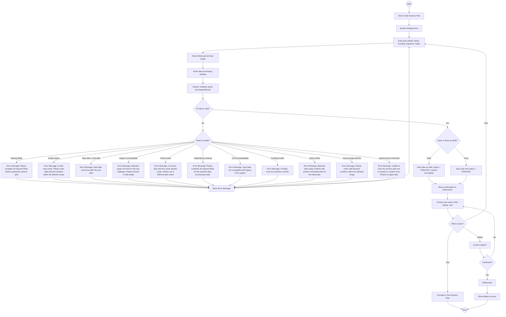
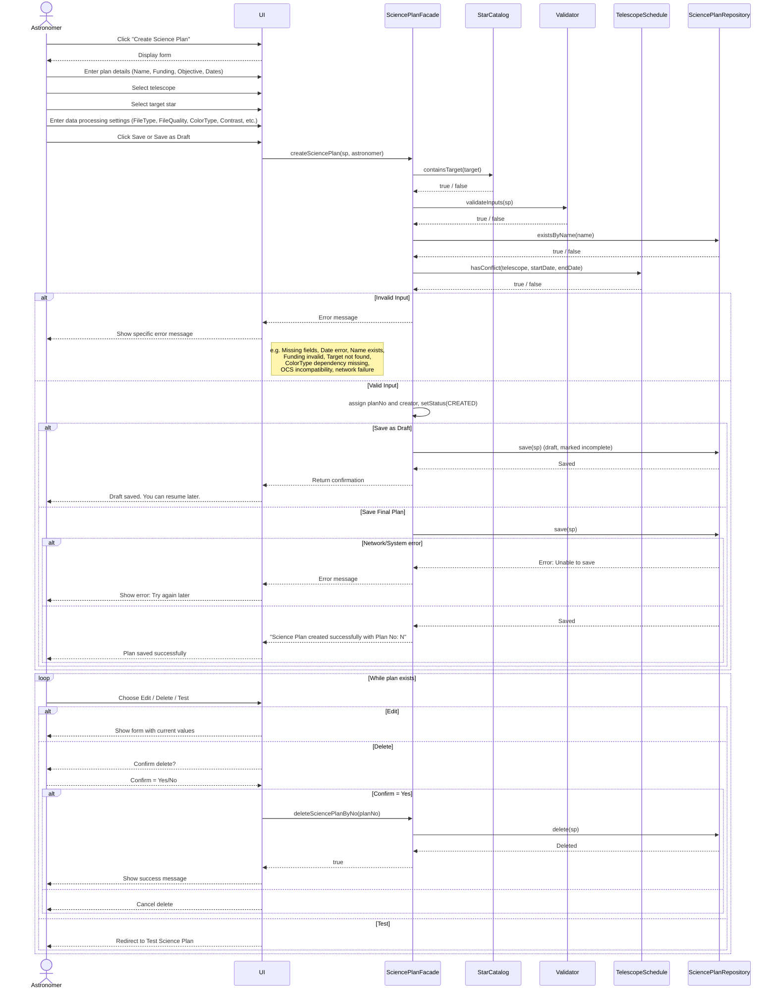
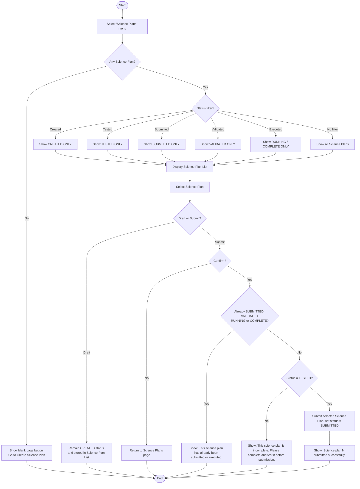
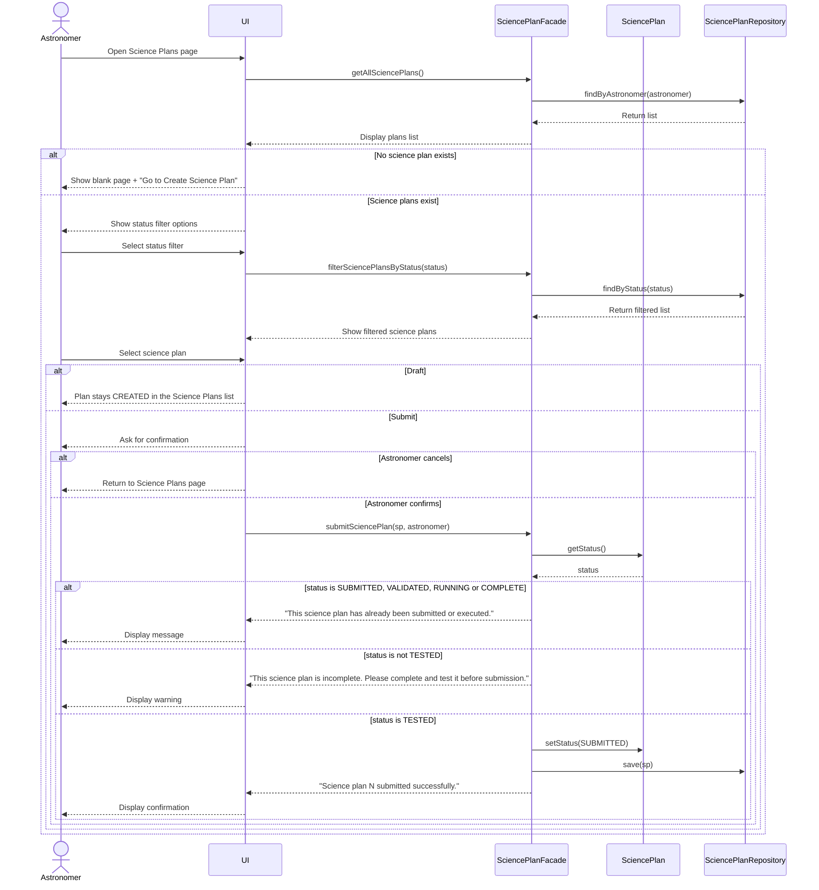
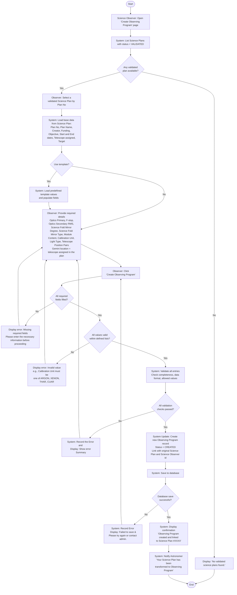
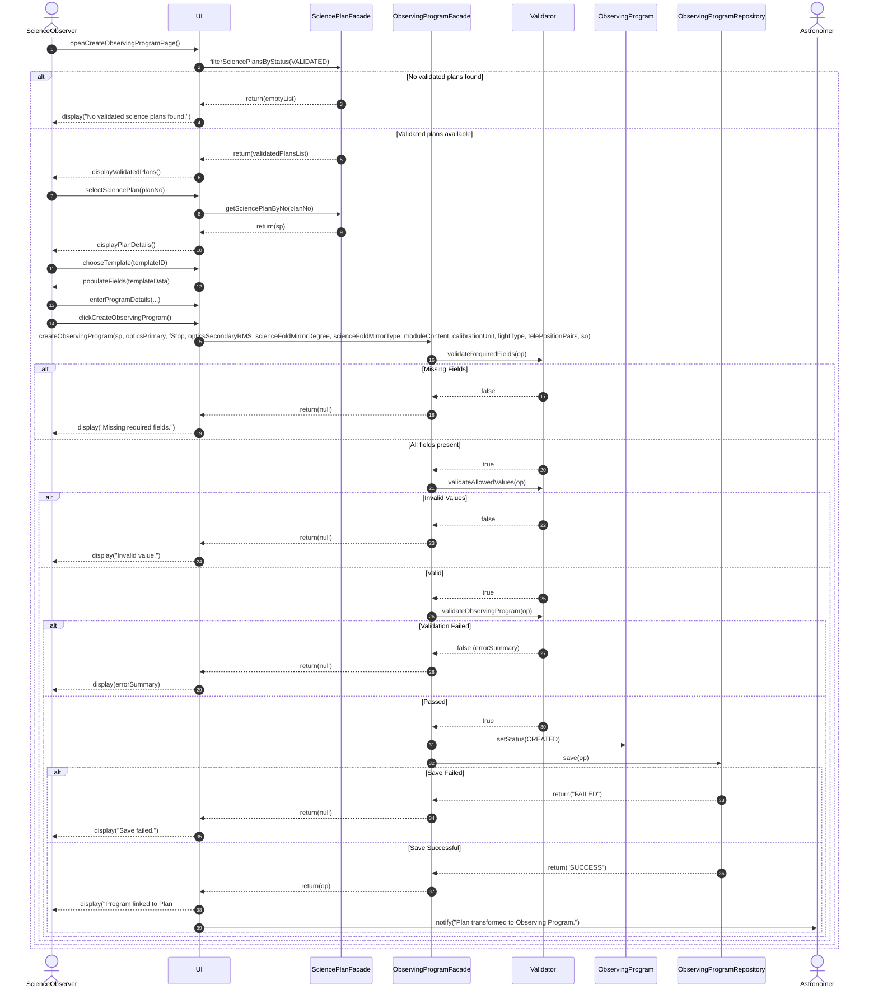
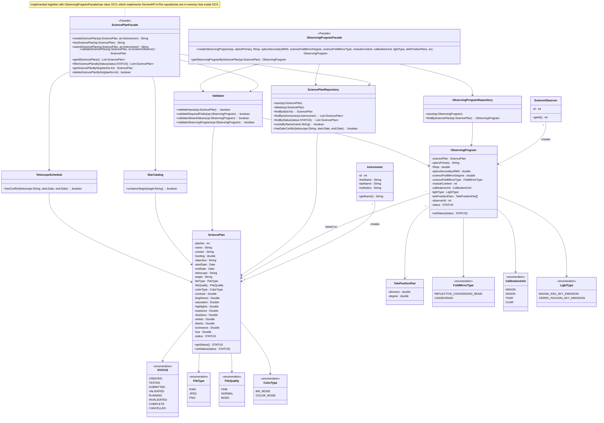

> **Phase 2 design (D4).** These diagrams cover the three assigned use cases. Method, field and status names follow the implementation in `gemini-1/implementations/ocs` where it exists. The design separates `SciencePlanFacade`, `ObservingProgramFacade`, repositories and helper classes; the implementation consolidates the two facades and the repositories into the single class `OCS` (which implements `GeminiAPI`), and does not implement `Validator`, `StarCatalog` or `TelescopeSchedule` (see the README).

## Create Science Plan Activity Diagram

## Create Science Plan Sequence Diagram

## Submit Science Plan Activity Diagram

## Submit Science Plan Sequence Diagram

## Create Observing Program Activity Diagram

## Create Observing Program Sequence Diagram

# Class Diagram

